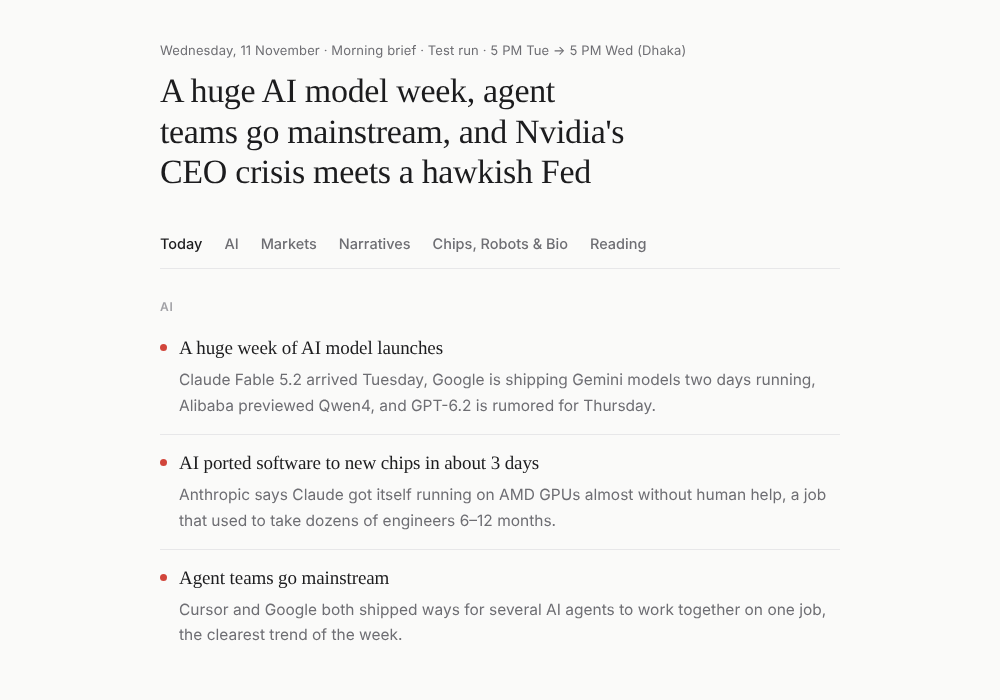

# Market Brief

An AI-generated, twice-daily brief that turns a noisy X (Twitter) feed into a calm, readable summary of **AI**, **tech** and **US-market** news.

**[View the live demo →](https://mashrafi360.github.io/Personal-AI-and-Market-brief/)** (shows a sample brief)



## The problem
Following hundreds of AI researchers, tech accounts, news feeds and market analysts on X means constant notifications, duplicate stories and lots of noise, such as chart spam and memes.

## What it does
Twice a day, in a morning window (8–10 AM) and a night window (8–10 PM), an AI agent:

1. **Reads** three curated private X Lists: Tech, Market News, and Traders & Analysts.
2. **Filters** out noise: chart and technical-analysis posts, memes, replies and low-engagement posts.
3. **Merges** duplicates, so ten posts about one event become one story with several sources.
4. **Ranks** stories by importance (high / medium / low) and sorts them into sections.
5. **Writes** a summary for each story, with "Why it matters", optional "In detail" and "Explain simply" versions, and plain definitions of jargon.
6. **Publishes** to a web page and sends a phone notification.

If the laptop running the browser is offline, it falls back to building the brief from web news sources.

Each brief starts exactly where the previous one ended, so nothing is missed or repeated.

## Sections
| Tab | What's in it |
|---|---|
| **Today** | Top 3 AI stories, top 3 market stories, and what to watch next |
| **AI** | Models, tools & agents, research, industry, and explainers |
| **Markets** | Market-moving news, filtered by priority |
| **Narratives** | What traders are telling each other: new, growing, split, or fading |
| **Chips, Robots & Bio** | Semiconductors, robotics and biotech |
| **Reading** | The best long posts and threads |

## How it's built
- **Agent:** [Claude](https://claude.ai), running as a scheduled task with browser access.
- **Instructions:** [`playbook.md`](playbook.md), the full set of rules the agent follows each run (timing, sources, writing style, publishing).
- **Front end:** a single `index.html` (no framework) that renders `brief.json`.
- **Data:** [`brief.json`](brief.json) holds the current brief, the coverage window, and the last 14 briefs.

```
X Lists ──► agent reads & filters ──► ranks & writes ──► brief.json ──► index.html
                 │ (laptop offline)
                 └──► web news fallback
```

## Run the demo locally
```bash
git clone https://github.com/YOUR-USERNAME/market-brief.git
cd market-brief
python -m http.server 8000
# open http://localhost:8000
```
(Opening `index.html` directly from a file won't load `brief.json`; use a local server.)

## Notes
- The sample brief is from 11 November 2026 and is included for demonstration.
- Summaries link back to the original posts. This project reports what sources say and is **not financial advice**.
